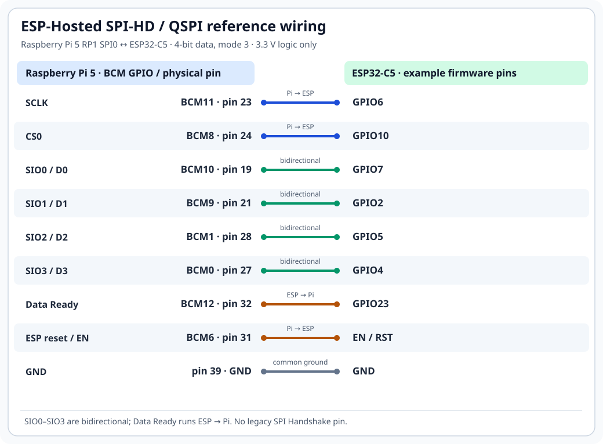

# SPI-HD / QSPI on Raspberry Pi 5

ESP-Hosted SPI-HD uses ESP SPI Slave-HD v2. Control transactions use a
single data line. Data transfers can use four bidirectional lines
(SIO0–SIO3). SPI-HD is separate from standard full-duplex SPI and needs
no Handshake GPIO.

## Hardware requirements

- ESP32-S2, ESP32-S3, ESP32-C2, ESP32-C3, ESP32-C5, ESP32-C6,
  ESP32-C61 or ESP32-S31 with SPI Slave-HD v2. Original ESP32 lacks
  this peripheral.
- Linux host with a quad-capable SPI controller and driver supporting
  command/address/data transfers and chip-select control.
- GPIO for Data Ready and optional ESP reset.
- Common ground and 3.3 V logic.

Raspberry Pi 5 RP1 SPI0 serves as reference host. Pi 4 and older onboard
SPI controllers lack quad support. Other hosts need compatible controller
drivers and pin configuration.

## Raspberry Pi 5 wiring



Pi GPIOs use BCM numbering. Header pin numbers refer to Raspberry Pi
40-pin connector. ESP GPIOs match default ESP32-C5 SPI-HD configuration.

SIO0–SIO3 are bidirectional. Use SPI mode 3 on both ends. Keep wiring short
and verify ESP board pin assignments before connecting hardware. No
separate SPI Handshake line is needed.

### Default ESP GPIO assignments

Select pins through **Example Configuration → SPI Half-duplex/QIO
Configuration** in ESP-IDF menuconfig.

| ESP target | CS | CLK | D0 | D1 | D2 | D3 | Data Ready |
|---|---:|---:|---:|---:|---:|---:|---:|
| ESP32-S2 / ESP32-S3 | 10 | 12 | 11 | 13 | 14 | 9 | 4 |
| ESP32-C2 | 10 | 0 | 7 | 2 | 5 | 4 | 1 |
| ESP32-C3 / ESP32-C6 | 10 | 6 | 7 | 2 | 5 | 4 | 11 |
| ESP32-C5 | 10 | 6 | 7 | 2 | 5 | 4 | 23 |
| ESP32-C61 | 8 | 6 | 7 | 2 | 4 | 3 | 23 |
| ESP32-S31 | 10 | 6 | 7 | 2 | 5 | 4 | 11 |

Values above refer to ESP GPIOs. Some boards reserve pins for flash,
PSRAM or boot functions. Check board schematics and adjust configuration
where needed.

## Build ESP firmware

Set up ESP-IDF as described in
[Build, flash, and load](getting-started/build-and-flash.md).

```sh
cd esp/esp_driver/network_adapter
idf.py set-target esp32c5
idf.py menuconfig
```

Select **Example Configuration → Transport layer → SPI half-duplex/QIO
interface**. Check SPI mode 3 and GPIO assignments under **SPI
Half-duplex/QIO Configuration**. DMA append, TX batching and TX length
mirroring are enabled by default.

Build and flash using ESP board serial port:

```sh
idf.py build
idf.py -p /dev/ttyUSB0 flash
```

Change target and serial port for your board.

## Set up Raspberry Pi 5

RP1 SPI0 needs a Linux controller driver with quad-transfer support.
Build controller modules against running kernel before loading
ESP-Hosted:

```sh
cd host
bash rpi5_spi_hd/build-rp1-quad-modules.sh --load
```

This command replaces loaded SPI controller modules. Run it only when
other devices on same SPI bus are idle.

Build and load SPI-HD host driver:

```sh
./rpi_init.sh spi_hd resetgpio=6 datareadygpio=12 \
    max_frequency=40000000 spi_hd_qio_addr_single=1
```

`resetgpio` and `datareadygpio` use Pi BCM numbering.
`spi_hd_qio_addr_single=1` selects RP1 address-phase mode. Other hosts
need their own controller and Device Tree configuration.

## Verify connection

Check module load, SPI probe and Wi-Fi interface:

```sh
lsmod | grep esp32_spi_hd
dmesg | grep -i -E 'spi.hd|esp32'
iw dev
ip link
```

If Wi-Fi interface is missing, check ESP UART log and host `dmesg`.
Verify GPIOs, SPI mode, Data Ready signal, quad support and SPI0 driver
ownership. See [Troubleshooting](troubleshooting.md).
